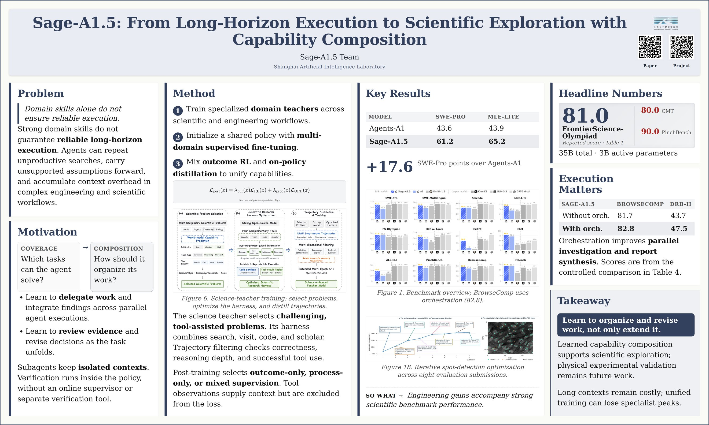
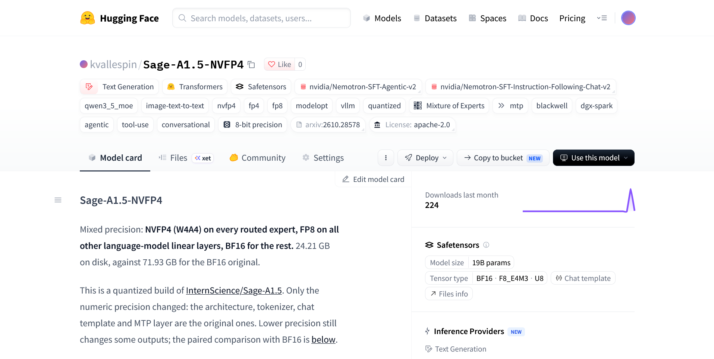

# Sage-A1.5, the 35B scientist that fits a desktop

*Running a leaner Sage-A1.5 on my own gear, with near-identical output and almost double decode speed.*



> **Disclosure:** I use AI as a writing partner to refine my prose and structure, but the ideas, analysis, and first drafts originate entirely with me.

It's no secret by now that I'm a big fan of Chinese AI labs. I've been running popular open-weight local LLMs for a while now, starting with DeepSeek, GLM (by Z.ai), and my current daily-driver resident, Qwen3.8-Flash-Next and its previous versions, by Alibaba. These models have never disappointed me, with all personal sovereign AI applications, and in turn convinced me that open source AI, from Chinese, European, or American labs alike, can serve as a counterforce to the extremely tightening grip of frontier AI Labs.

Enter Sage-A1.5, from Shanghai AI Laboratory (through its open-source research arm, InternScience). Released October 20, 2026, this model is a 35-billion-parameter model built for agentic work. The interesting number isn't the headline size: only about 3 billion parameters do work per token, which is why compressing it pays.

## Why I bothered

The original costs 72 GB on disk and some 70 GB of memory to run, obviously never going to fit my rig. So the goal was never to prove quantization works. It was to get a scientist-class agent onto the desk I already pay for. What follows is what that sacrifice cost me, down to the one benchmark where it full precision took a hit.

## Where the numbers live

Most of those 35 billion parameters sit in a mixture of experts: 256 specialists on call at each of the model's 40 layers. A router reads your token and wakes a handful; everyone else stays asleep. That's the "A3B" in its Qwen3.6-35B-A3B base, 35B total, 3B active. Sage adds orchestration (sub-questions handed to parallel sub-agents), verification (it audits its own failing reasoning), and open-ended science. None of that changed in my build: same architecture, tokenizer, chat template, MTP layer. Only precision moved, down to 24.21 GB.

## What NVFP4 is and what it does

Weights are numbers, 35 billion of them. BF16, the default format, spends 16 bits per number: a ruler with lots of tick marks. Does every weight need one that fine? Mostly no. Whether it is 0.031 or 0.030 rarely changes what the model writes. NVFP4 is a 4-bit floating-point format for NVIDIA Blackwell GPUs that reduces memory bandwidth and storage while keeping accuracy close to higher-precision formats. Unlike uniform INT4, it keeps floating-point semantics with a shared exponent and a compact mantissa, which improves dynamic range. Blackwell Tensor Cores support mixed-precision execution across FP16, FP8, and FP4, so models can use FP4 for weights and activations while accumulating in higher precision (typically FP16).

NVFP4 spends 4 bits instead; an FP4 number takes one of exactly 15 values. That works only if nearby weights are similar in size. So it groups: take 16 neighboring weights, find the biggest, and scale so the block's largest value lands on the top rung. All 16 round to one of 15 rungs on a ladder sized for that block. NVIDIA's Model Optimizer ran the arithmetic via its nvfp4_experts_mse-fp8_rest-kv_fp8 recipe, nothing retrained.

## Where each bit went

| Part | Format | Size |
|---|---|---|
| Routed experts, 40 layers (256 each) | NVFP4, weights and activations (W4A4) | 18.12 GB |
| Linear attention projections (90) | FP8 E4M3 | 1.02 GB |
| Full attention q / k / v / o (40) | FP8 E4M3 | 0.27 GB |
| Shared experts (120 projections) | FP8 E4M3 | 0.13 GB |
| KV cache (10 full-attention layers) | FP8 E4M3 | n/a |
| Embeddings and lm_head | BF16 | 1.02 + 1.02 GB |
| Routers, gates, conv1d, norms | BF16 | 0.04 GB |
| Vision tower | BF16, unchanged | 0.89 GB |
| MTP layer (785 tensors) | BF16, byte-identical | 1.69 GB |
| **Total** | | **24.21 GB** |

The routed experts hold 18 GB, the loudest place to save bits since few fire per token, so they took the hardest hit. Attention and shared experts are small but sensitive: FP8. Routers and norms steer everything downstream, so BF16 stayed. Calibration used 512 samples: 320 agentic web-search trajectories and 192 instruction-following chats.

## Does it still think the same way?

I served both builds on one DGX Spark with the same vLLM nightly, flags, and chat template, decoding greedily at temperature 0 on items held out of calibration.

| Task | Items | BF16 | NVFP4 | Difference, pp (95% CI) | p |
|---|---|---|---|---|---|
| Agentic next action | 460 | 50.0 | 52.2 | +2.2 (−2.4 to +6.7) | 0.40 |
| BFCL v3 AST | 1,000 | 83.5 | 81.4 | **−2.1 (−3.9 to −0.3)** | **0.03** |
| IFEval strict | 541 | 83.2 | 82.8 | −0.4 (−3.0 to +2.2) | 0.89 |
| IFEval loose | 541 | 87.4 | 87.1 | −0.4 | |

On agentic next-action the point estimate favors the quantized build, but the interval straddles zero. Noise, not a win. On BFCL the interval excludes zero: a real regression of 2.1 points, and I'd rather report it than bury it. Exact syntax is unforgiving, so test this build on your own tools.

| Held-out text | Tokens | Perplexity ratio | Top-1 agreement | KLD mean |
|---|---|---|---|---|
| Chat conversations (200) | 255,393 | 1.004 | 94.3% | 0.035 |
| General text, wikitext-2 | 296,815 | 1.010 | 92.1% | 0.031 |
| Reasoning (long traces) | 66,429 | 1.002 | 96.3% | 0.008 |
| Tool calls (long traces) | 8,212 | 0.981 | 98.7% | 0.010 |
| Answers | 1,260 | 1.005 | 97.9% | 0.006 |
| Tool output (pages it reads) | 434,702 | 0.955 | 76.0% | 0.408 |
| Positions 16K-32K | 260,165 | 0.953 | 79.0% | 0.357 |

Does it write the same words? On reasoning, tool calls, and answers, agreement runs 96 to 99%, at 32K-token contexts. The divergence sits in tool output: scraped web text the model reads but never writes, where both models are uncertain. Note the direction. This build's perplexity there is *lower* than BF16's. Damage would show up where the model generates text. It doesn't.

## The payoff

| | BF16 | NVFP4 | Ratio |
|---|---|---|---|
| Decode, 1 stream (tokens/s) | 28.3 | 53.0 | 1.87x |
| Decode, 4 streams aggregate | 99.6 | 158.9 | 1.60x |
| Prefill, 8K prompt (tokens/s) | 4,105 | 6,123 | 1.49x |
| Time to first token (s) | 0.146 | 0.098 | 0.67x |
| Checkpoint on disk (GB) | 71.93 | 24.21 | 0.34x |

Nearly 3x less storage, about 1.9x faster generation, first response in two thirds the time. Generating tokens one at a time is bound by reading weights from memory, so cutting bytes raises throughput almost for free. Blackwell (sm_121) also has native FP4 math:

```shell
vllm serve kvallespin/Sage-A1.5-NVFP4 \
  --quantization modelopt \
  --kv-cache-dtype fp8 \
  --max-model-len 65536 \
  --gpu-memory-utilization 0.5 \
  --reasoning-parser qwen3 \
  --enable-auto-tool-choice \
  --tool-call-parser qwen3_coder \
  --speculative-config '{"method": "mtp", "num_speculative_tokens": 3}'
```

Add `--language-model-only` to skip the vision tower and reclaim 0.9 GB. The weights live at [kvallespin/Sage-A1.5-NVFP4](https://huggingface.co/kvallespin/Sage-A1.5-NVFP4), my corner of Hugging Face, population: one quantized scientist, sitting next to my first NVFP4 quantization of a creative writing model called Hemmingway-1. Pull it and tell me where it breaks.



## Caveats

GSM8K, MMLU-Pro, and long-horizon suites like SWE-bench and GAIA aren't compared yet, nor the verification and orchestration modes specifically. Everything used greedy decoding, not Sage's recommended sampling, on GB10 with one vLLM build. Don't read InternScience's chart as applying to these weights.

## A personal note

Three numbers carried this post: 96 to 99% agreement on generated tokens, so the compression held; 1.9x faster, so it was worth doing; minus 2.1 points on BFCL with an interval excluding zero, so it wasn't free. Sage-A1.5 on NVFP4 let me test the model myself instead of trusting a chart, and in the end was an honest trade. I'm running and benchmarking Sage now, so I'll report what I see soon as the numbers are ready.

---

## Sources

- Sage-A1.5 technical report (arXiv:2610.28578): <https://arxiv.org/abs/2610.28578>
- Sage-A1.5 paper page on Hugging Face: <https://huggingface.co/papers/2610.28578>
- My quantized model card, kvallespin/Sage-A1.5-NVFP4: <https://huggingface.co/kvallespin/Sage-A1.5-NVFP4>
- Original model, InternScience/Sage-A1.5: <https://huggingface.co/InternScience/Sage-A1.5>
- Sage-A1.5 project page: <https://alpha-innovator.github.io/Sage-A1.5/>
- InternScience/Agents-A1 (code and evaluation framework): <https://github.com/InternScience/Agents-A1>
- NVIDIA Model Optimizer: <https://github.com/NVIDIA/Model-Optimizer>
- nvidia/Nemotron-SFT-Agentic-v2 (calibration data): <https://huggingface.co/datasets/nvidia/Nemotron-SFT-Agentic-v2>
- nvidia/Nemotron-SFT-Instruction-Following-Chat-v2 (calibration data): <https://huggingface.co/datasets/nvidia/Nemotron-SFT-Instruction-Following-Chat-v2>
- Qwen3.6-35B-A3B base model: <https://huggingface.co/Qwen/Qwen3.6-35B-A3B>
